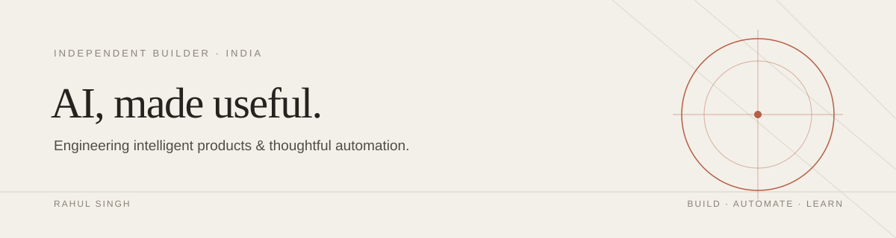

  

<h1 align="center">Rahul Singh</h1>

  <strong>AI Engineer · Automation Developer · Product Builder</strong>

  I build practical software that makes complex work simpler.
   
  Interested in applied AI, intelligent automation, and thoughtful product engineering.

---

### What I work on

- **Applied AI** — AI-powered workflows, LLM integrations, speech technologies, and intelligent assistants.
- **Automation** — Turning repetitive, people-heavy processes into dependable systems.
- **Product engineering** — Building SaaS platforms, internal tools, and useful web applications.
- **Web & platform development** — Full-stack applications, performance, and SEO-aware architecture.

### Selected work

A few problem spaces and products I've been building:

| Project | What it explores |
| --- | --- |
| RecruitOps | Recruitment operations and workflow intelligence |
| FocusDrive | Workforce activity insights and productivity workflows |
| MotoSutra | Automotive content and discovery |
| KompressPDF | Practical PDF productivity tools |
| PD-TV | Digital signage and display experiences |
| MindSupremacy | Personal growth and learning experiences |

*Some of these are private or in active development; this profile describes the work without exposing private source code.*

### Tools I use

**Languages:** TypeScript, JavaScript, Python  
**Frontend:** React, Next.js, Astro  
**Backend & data:** Node.js, PostgreSQL, Supabase  
**AI & integrations:** OpenAI APIs, Whisper, ElevenLabs, Microsoft Graph  
**Infrastructure:** Docker, GitHub, Vercel, Linux

### Outside of building

Storytelling, visual design, music production, basketball, and exploring new places. Always learning, experimenting, and building.

---

  <em>Build with intention. Ship with purpose. Keep learning.</em>

